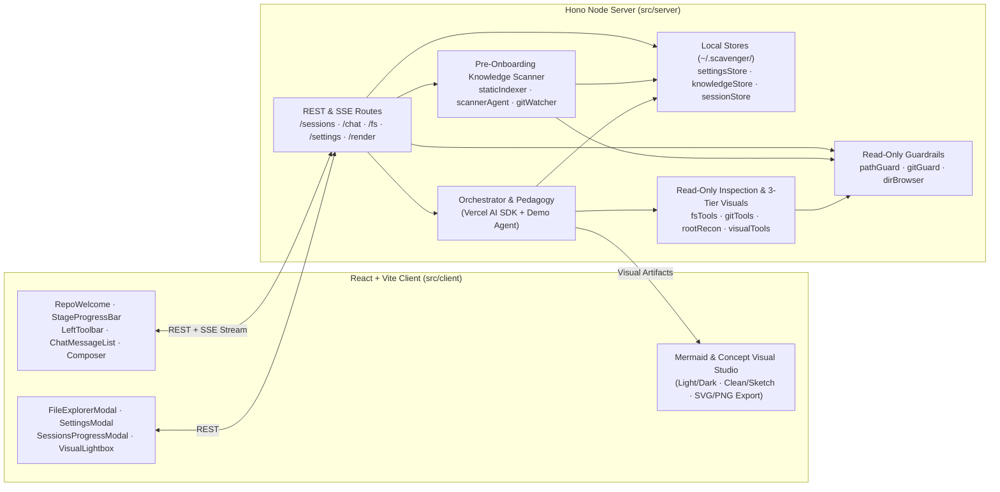

# Scavenger

> **Understand any local codebase from the root up — through interactive whiteboard lessons, live diagrams, and strictly read-only exploration.**

Scavenger is a local **Repository Onboarding Agent** with a clean, Gemini-inspired chat interface. Instead of dumping raw file listings or flat API summaries, Scavenger acts like a **Senior Software Architect & Whiteboard Mentor** sitting next to you: it inspects your repository strictly read-only, adapts explanations to your experience level, draws architectural and runtime diagrams inline, and tracks your evolving mastery as you explore.

---

## Highlights

- **Pre-Onboarding Repo Scanner Agent & Persistent Knowledge Base:** Before onboarding starts, Scavenger scans the repository (indexing files, exported symbols with line numbers, cross-file imports/dependencies, entry points, and module boundaries) with live streaming progress and synthesizes a **Repository Knowledge Map**. The onboarding agent answers architectural, module, and flow questions immediately from the Knowledge Map (`query_knowledge_map`) and dives into raw code lines on demand.
- **Auto-Refresh on `git pull` & On-Demand Refresh:** Scavenger tracks the repository's `HEAD` commit SHA, automatically detects when a `git pull` updates the local repo, incrementally re-indexes only the diffed files (`git diff --name-status`), and provides a 1-click **Refresh KB** action in the left toolbar.
- **Persistent Sessions & Cross-Session Mastery:** Onboarding sessions and cumulative per-repository mastery are persisted locally (`~/.scavenger/sessions/`), automatically restoring your active session across browser refreshes and letting you resume prior sessions, start fresh, or review cross-session progress at any time.
- **Zero-Commit Local Storage (`~/.scavenger/`):** Both knowledge maps (`~/.scavenger/knowledge/`) and saved sessions (`~/.scavenger/sessions/`) are stored outside the target repository with `0600` permissions and an auto-generated inner `.gitignore` (`*`), plus explicit `.gitignore` and `pathGuard` exclusions so Scavenger artifacts are **never** committed or pushed.
- **Whiteboard Mentor Pedagogy & Marker Highlights:** Teaches in flowing, grounded narratives — mental models first, then interdependencies, behavior over time, subtle pitfalls, and memorable takeaways — with realistic yellow highlighter callouts (`==key takeaway==`) for core architectural invariants and zero dry file-inventory bullet soup.
- **Auto-Collapsing Left Toolbar & Non-Linear Learning:** Explore the 5 core repository pillars (**Recon**, **Purpose**, **Architecture**, **Flows**, **Evolution**) from the top rail in any order, or use the auto-collapsing **Left Toolbar** (expandable on hover or pinnable) to inspect the **Knowledge Base (`KB`)**, browse the interactive **Knowledge Map (`Map`)** (pillars, scanned architecture modules, and custom topics), open **Cross-Session Progress (`Progress`)**, or switch **Explanation Depth (`Depth`)**.
- **Visual-First Diagrams & 3-Tier Concept Art:**
  - Crisp **Mermaid** SVG diagrams rendered on an architectural dot-grid canvas with semantic color-coded roles, Light/Dark theme adaptation, a 1-click **Clean / Sketch** whiteboard style toggle, **Copy Source**, **SVG** and **2× Retina PNG** export, and an interactive **Zoom & Pan Lightbox**.
  - Optional local **D2** CLI rendering (`d2 --theme=1 --pad=28 - -`, zero disk writes) with automatic fallback.
  - **3-Tier Concept Illustrations:** Generates editorial metaphor visuals via **(1)** native multimodal image output from your active session model, **(2)** dedicated Gemini Imagen / OpenAI Images endpoints or bespoke LLM-authored `<svg>` diagrams, or **(3)** instant deterministic multi-layout vector concept maps (`pipeline`, `hub`, `layers`) offline.
- **Reading-First Streaming, Live Composer Progress & Light/Dark Theme:**
  - **No forced auto-scroll while streaming:** Read from the top of a lesson undisturbed while tokens and diagrams stream in below, with a floating downward arrow cue (`↓`) whenever new content appears below the viewport.
  - **Live Composer Status Banner:** Displays real-time phased progress (*Inspecting repository*, *Synthesizing lesson*, *Streaming response*), an elapsed timer, and live read-only tool pills while awaiting a response.
  - **Light & Dark Theme Toggle:** Instant 1-click theme switching in the top bar and welcome screen, persisted across sessions with theme-aware diagrams and typography.
- **Built-In Local File Explorer:** Click **Browse** on the welcome screen to pick any repository on disk visually with Git repository badges, clickable breadcrumbs, OS shortcuts (`Home`, `Workspace`, `Desktop`, `Documents`, `Root`), instant folder filtering, and keyboard navigation.
- **In-App Settings Menu (No `.env` Required):** Configure API keys, switch between **GitHub Copilot** (auto-detects local Copilot IDE/CLI auth or signs in via in-app GitHub Device Flow, supports Enterprise domains, and discovers live models enabled on your subscription), **Google Gemini**, **OpenAI**, **Anthropic Claude**, **OpenAI-Compatible** (Ollama, LM Studio, OpenRouter), or zero-key **Demo Mode**, pick curated model presets or custom model IDs, and **Test Connection** live — persisted locally with `0600` permissions and zero restarts.
- **Strict Backend-Enforced Read-Only Guardrails:** Every filesystem and git inspection tool is strictly confined and lock-free — Scavenger never modifies files, creates git locks, or mutates your repository.

---

## Quickstart

### Prerequisites

- **Node.js** `>= 20`
- **pnpm** (`npm install -g pnpm` or via `corepack enable`)
- *(Optional)* **[D2 CLI](https://d2lang.com/)** (`brew install d2`) if you want local D2 diagram rendering alongside Mermaid

### 1. Clone and install

```bash
git clone https://github.com/marcopt74/scavenger.git
cd scavenger
pnpm install
```

### 2. Start Scavenger

```bash
pnpm dev
```

Open **[http://localhost:5173](http://localhost:5173)** in your browser (the Hono backend API runs on `http://localhost:3001`).

> **Zero-key Demo Mode works out of the box.** You can onboard any local repository immediately without configuring an API key — Demo Mode runs real read-only filesystem and git inspection against your codebase and renders grounded lessons and diagrams.

### Production Build

```bash
pnpm build
pnpm start
```

The production server serves both the API and the compiled frontend bundle from `http://localhost:3001` (or `PORT` if set).

---

## Configuring LLM Providers & API Keys

### Option 1: In-App Settings Menu *(Recommended)*

No need to edit `.env` files or restart the server:

1. Click the **Provider** chip on the welcome screen (or the **⚙ Settings** icon in the top bar at any time).
2. Under **Models & Provider**, choose your provider:
   - **GitHub Copilot** — automatically detects existing local Copilot authentication (`~/.config/github-copilot/{hosts,apps}.json`, `~/.copilot/config.json`, or `gh auth token`), supports 1-click **Sign in with GitHub Copilot** Device Flow, and dynamically loads all chat models enabled on your Copilot subscription (`gpt-4.1`, `gpt-4o`, `claude-sonnet-4`, `gemini-2.5-pro`, `o3-mini`, etc.)
   - **Google Gemini** (`gemini-2.5-flash`, `gemini-2.5-pro`, `gemini-2.0-flash`, or custom model ID)
   - **OpenAI** (`gpt-4o`, `gpt-4.1`, `gpt-4.1-mini`, `o3-mini`, or custom model ID)
   - **Anthropic Claude** (`claude-sonnet-4-20250514`, `claude-3-7-sonnet-latest`, `claude-3-5-haiku-latest`, or custom model ID)
   - **OpenAI-Compatible** — includes 1-click endpoint presets for **Ollama** (`http://localhost:11434/v1`), **LM Studio** (`http://localhost:1234/v1`), and **OpenRouter** (`https://openrouter.ai/api/v1`)
   - **Local Demo Mode** (zero API key)
3. Add your API key inline or under the **API Keys** tab, then click **Test Connection** to verify credentials and latency before saving.
4. *(Optional)* Under **Visuals & Safety**, toggle **AI Concept Image Generation**, choose whether to **Use Active Session Model for Visuals** (native multimodal image output or bespoke LLM SVG generation before dedicated image APIs), or customize the Gemini / OpenAI image model IDs.
5. Click **Save Settings**.

**Where settings are stored:** Settings are written atomically to `~/.scavenger/config.json` (outside the git repository) with owner-only `0600` file permissions. Raw API keys are **never** sent back to the browser — the UI only displays masked previews (e.g. `AIza••••3x8Q`) and source badges (`Saved in Settings` vs `From .env`).

### Option 2: `.env` File *(Optional)*

You can also configure defaults via `.env` (UI Settings override `.env` at runtime, and removing a key in Settings falls back cleanly to `.env`):

```bash
cp .env.example .env
```

| Variable | Description | Default |
| --- | --- | --- |
| `PORT` | Backend server port | `3001` |
| `LLM_PROVIDER` | `copilot` \| `google` \| `openai` \| `anthropic` \| `openai-compatible` \| `demo` | Auto-detected or `demo` |
| `LLM_MODEL` | Optional default model override | Provider default |
| `GITHUB_COPILOT_TOKEN` | GitHub Copilot OAuth token (optional if auto-detected locally or signed in via UI) | Auto-detected |
| `GITHUB_COPILOT_DOMAIN` | Optional organizational / Enterprise GitHub domain (e.g. `company.ghe.com` or `github.company.com`) | `github.com` |
| `GOOGLE_GENERATIVE_AI_API_KEY` | Google Gemini API key (`GEMINI_API_KEY` also supported) | — |
| `OPENAI_API_KEY` | OpenAI API key | — |
| `ANTHROPIC_API_KEY` | Anthropic Claude API key | — |
| `OPENAI_COMPATIBLE_BASE_URL` | Base URL for Ollama / LM Studio / OpenRouter / vLLM | `http://localhost:11434/v1` |
| `OPENAI_COMPATIBLE_API_KEY` | Optional API key for OpenAI-compatible servers | — |
| `IMAGE_GEN_ENABLED` | Enable concept illustrations (`true` \| `false`) | `true` |
| `GEMINI_IMAGE_MODEL` | Gemini Imagen model ID | `imagen-3.0-generate-002` |
| `OPENAI_IMAGE_MODEL` | OpenAI Images model ID | `gpt-image-1` |
| `SCAVENGER_CONFIG_PATH` | Override path for local persistent settings file | `~/.scavenger/config.json` |
| `SCAVENGER_KNOWLEDGE_DIR` | Override directory for local repository knowledge maps | `~/.scavenger/knowledge` |
| `SCAVENGER_SESSIONS_DIR` | Override directory for persistent onboarding sessions | `~/.scavenger/sessions` |

---

## Using Scavenger

### 1. Select or Resume a Local Repository
On the welcome screen, choose a repository in any of four ways:
- Click **Browse** inside the path bar to open the **File Explorer modal** — jump via **Places** shortcuts, spot Git repositories via `git` badges, filter folders instantly, double-click (or click `›`) to drill down, and click **Select Folder**.
- Click **Inspect current workspace** to immediately onboard the directory Scavenger was launched from.
- Type or paste any local path (including `~` expansion) and click **Start Onboarding**.
- Resume any previous session from the **Recent Onboarding Sessions & Repository Progress** panel on the welcome screen, or click **New Session** to start a fresh walkthrough while retaining your cumulative repository mastery.

### 2. Pre-Onboarding Knowledge Scan, Root Recon & Calibration
Scavenger runs a fast, read-only **Repository Knowledge Scan** (streaming progress phases to the screen) alongside deterministic root reconnaissance (top-level layout, README, root manifests/configs, and recent git commits), then opens with a grounded orientation and quick depth calibration nudges:
- **Foundational:** Mental models, everyday analogies, plain definitions before abstractions.
- **Intermediate:** Balanced architecture, module contracts, runtime flows, and entry points.
- **Advanced:** Staff-level invariants, state/lifecycle trade-offs, coupling tensions, and git rationale.

You can recalibrate depth at any time using the **Depth** control in the left toolbar or by simply asking in chat (*"Explain simpler"* / *"Go deeper"*).

### 3. Learn Non-Linearly with the Top Rail & Left Toolbar
You are never locked into a rigid script:
- Click any **Core Pillar** (`Recon`, `Purpose`, `Architecture`, `Flows`, `Evolution`) in the top bar.
- Hover over (or pin open) the **Left Toolbar** to access:
  - **Knowledge Base (`KB`):** View the number of indexed files and symbols, check git sync status, or click the refresh button (`↻`) to re-scan on demand.
  - **Knowledge Map (`Map`):** Inspect mastery progress across core pillars, click any **Scanned Architecture Module** to learn how it works, or revisit custom topics you've explored.
  - **Progress (`Progress`):** Open the **Sessions & Progress modal** to view cumulative mastery across all repositories, switch between saved sessions, or start a fresh session.
  - **Depth (`Depth`):** Switch between `Auto`, `Foundational`, `Intermediate`, and `Advanced` teaching depth.
- Reply to inline **Quick Check** questions to reinforce or advance mastery, click any **Suggested Next Step** card, or type any question directly (*"Teach me how `pathGuard.ts` works"*, *"Walk through the SSE chat flow over time"*).
- Click the **Tool Activity pill** above any response to inspect the exact read-only files, knowledge map queries, and git commands Scavenger grounded its answer in.

### 4. Inspect & Export Visuals
Every diagram and concept visual renders directly inline as an interactive studio card:
- **Sketch / Clean toggle** (Mermaid): Switch between crisp architectural vector styling and hand-drawn whiteboard sketch mode (automatically adapted to **Light** or **Dark** theme).
- **Expand (Lightbox):** Inspect dense diagrams full-screen with zoom (`+`, `-`, `0`, `Ctrl/⌘ + scroll`), click-and-drag panning, and `Esc` to close.
- **Export:** Download crisp **SVG**, **2× Retina PNG**, or copy raw diagram source with one click.

---

## Read-Only Security Guardrails

Scavenger is designed so you can point it at important local repositories with confidence:

- **Filesystem confinement ([`pathGuard.ts`](src/server/guardrails/pathGuard.ts)):** Every agent tool (`list_tree`, `read_file`, `grep_search`) resolves canonical `fs.realpath` paths strictly inside the chosen repository root — blocking `../` traversal, external absolute paths, null bytes, symlink escapes outside the repo, and direct `.git/` internal file reads.
- **Lock-free, shell-free Git ([`gitGuard.ts`](src/server/guardrails/gitGuard.ts)):** Runs `execFile('git', ...)` with `shell: false`, enforces a strict read-only subcommand allowlist (`log`, `show`, `diff`, `blame`, `shortlog`, `status`, `rev-parse`, `branch --list`, `tag --list`, `ls-files`), blocks mutating flags, and injects `GIT_OPTIONAL_LOCKS=0` so even `git status` never writes `.git/index.lock`.
- **Read-only folder browser ([`dirBrowser.ts`](src/server/tools/dirBrowser.ts)):** Lists directory metadata only (never reads file contents), caps listings at 500 entries, and detects `.git` markers without spawning subprocesses.
- **Local-only secret & session storage ([`settingsStore.ts`](src/server/settingsStore.ts), [`knowledgeStore.ts`](src/server/knowledge/knowledgeStore.ts), [`sessionStore.ts`](src/server/session/sessionStore.ts)):** API keys (`~/.scavenger/config.json`), scanned knowledge maps (`~/.scavenger/knowledge/`), and saved sessions (`~/.scavenger/sessions/`) stay on your machine with `0600` permissions and auto-generated `.gitignore` protection, and raw secrets are never echoed back in API responses.

---

## Architecture



```text
src/
├── shared/
│   └── types.ts                   # Shared domain, knowledge map, session, visual & settings types
├── server/
│   ├── index.ts                   # Hono entrypoint, /api/health & static production serving
│   ├── config.ts                  # Provider-agnostic Vercel AI SDK model resolver
│   ├── copilotAuth.ts             # GitHub Copilot token discovery, Device Flow & live model list
│   ├── settingsStore.ts           # Persistent local config store (~/.scavenger/config.json)
│   ├── guardrails/
│   │   ├── pathGuard.ts           # Canonical realpath repo confinement & symlink defense
│   │   └── gitGuard.ts            # Lock-free, shell-free read-only git allowlist
│   ├── knowledge/
│   │   ├── staticIndexer.ts       # Fast read-only AST/regex symbol, import & entrypoint indexer
│   │   ├── scannerAgent.ts        # Hybrid static + LLM repository knowledge map synthesizer
│   │   ├── knowledgeStore.ts      # Persistent knowledge cache (~/.scavenger/knowledge/)
│   │   └── gitWatcher.ts          # HEAD SHA tracker & git diff incremental refresh detector
│   ├── tools/
│   │   ├── fsTools.ts             # Read-only list_tree, read_file, grep_search
│   │   ├── gitTools.ts            # Read-only git_inspect wrapper
│   │   ├── dirBrowser.ts          # Read-only local directory browser for FileExplorerModal
│   │   ├── rootRecon.ts           # Deterministic Stage 0 root reconnaissance
│   │   ├── visualTools.ts         # D2 CLI renderer & 3-tier multimodal/LLM-SVG/vector concept engine
│   │   └── agentTools.ts          # Vercel AI SDK tool suite (incl. query_knowledge_map)
│   ├── session/
│   │   ├── sessionStore.ts        # Persistent session store (~/.scavenger/sessions/) & cross-session progress
│   │   ├── learningEngine.ts      # Non-linear topic mastery, check-ins & next-step engine
│   │   └── stageMachine.ts        # Stage progression & depth calibration heuristics
│   ├── agent/
│   │   ├── pedagogy.ts            # Whiteboard Mentor 5-beat teaching framework & highlighter rules
│   │   ├── systemPrompt.ts        # Grounded architect persona, knowledge digest & visual guidelines
│   │   ├── orchestrator.ts        # Multi-step streaming agent loop (SSE)
│   │   └── demoAgent.ts           # Grounded zero-key local demo responder
│   └── routes/
│       ├── sessions.ts            # Session CRUD, SSE scan init, knowledge status & refresh routes
│       ├── chat.ts                # POST /api/sessions/:id/chat (SSE)
│       ├── fs.ts                  # GET /api/fs/browse
│       ├── settings.ts            # Settings CRUD, connection test & Copilot Device Flow routes
│       └── visuals.ts             # POST /api/render/d2
└── client/
    ├── App.tsx                    # Minimalist chat shell, session restoration & SSE consumer
    ├── api/client.ts              # Typed REST & SSE API client
    ├── utils/
    │   ├── highlightMarkdown.ts   # Transforms ==highlight== syntax into realistic marker callouts
    │   ├── mermaidTheme.ts        # Light/Dark Mermaid v12 theme, lightbox SVG prep & PNG/SVG export
    │   └── theme.ts               # Persistent Light/Dark theme state & DOM attribute sync
    ├── styles/index.css           # Gemini-inspired design system with variable font typography
    └── components/
        ├── RepoWelcome.tsx        # Landing screen with Browse, scan progress & recent sessions
        ├── FileExplorerModal.tsx  # Local folder picker with breadcrumbs, filter & Git badges
        ├── SettingsModal.tsx      # 3-tab Settings UI (Models, API Keys, Visuals & Safety)
        ├── SessionsProgressModal.tsx # Cross-session repository mastery & session history modal
        ├── StageProgressBar.tsx   # Top bar with Repo pill, Core Pillar rail, Theme & Settings
        ├── LeftToolbar.tsx        # Auto-collapsing left rail for KB, Knowledge Map, Progress & Depth
        ├── ThemeToggleButton.tsx  # 1-click Light / Dark mode toggle button
        ├── ChatMessageList.tsx    # Reading-first prose stream with scroll-down cue & inline visuals
        ├── LessonFooter.tsx       # Inline Quick Check card & clickable Next Steps cards
        ├── MarkdownRenderer.tsx   # Markdown renderer with yellow highlights & DiagramCard interception
        ├── DiagramCard.tsx        # Mermaid/D2 studio card with Clean/Sketch toggle & export
        ├── ConceptVisualCard.tsx  # Multimodal artwork, bespoke LLM SVG or vector concept card
        ├── VisualLightbox.tsx     # Shared interactive zoom & drag-to-pan fullscreen lightbox
        ├── ToolActivityPill.tsx   # Collapsible grounded read-only inspection summary
        └── Composer.tsx           # Floating pill composer with live phased progress banner & nudges
```

---

## Development & Testing

| Script | Description |
| --- | --- |
| `pnpm dev` | Run backend (`tsx watch`, port `3001`) and frontend (`vite`, port `5173`) concurrently |
| `pnpm test` | Run all 17 Vitest suites (80 tests) |
| `pnpm typecheck` | Run TypeScript typechecking (`tsc --noEmit`) |
| `pnpm build` | Build production client (`dist/client`) and server (`dist/server`) |
| `pnpm start` | Run the compiled production server |

### Test Coverage (`tests/`)

- `pathGuard.test.ts` — Blocks `../` traversal, external absolute paths, null bytes, `.git/` and `.scavenger/` direct reads, and symlink escapes.
- `gitGuard.test.ts` — Enforces read-only git allowlists and rejects mutating subcommands and dangerous flags.
- `fsAndGitTools.test.ts` — Proves zero repository mutations (`git status --porcelain` clean, `HEAD` unchanged, no `.git/index.lock`).
- `dirBrowser.test.ts` — Verifies read-only directory browsing, `.git` repo/worktree detection, hidden folders, symlinks, breadcrumbs, fallback, and HTTP error codes.
- `knowledgeScanner.test.ts` — Verifies static symbol/import indexing, architecture synthesis, persistent knowledge storage (`0600` + `.gitignore`), `git pull` incremental refresh, and `query_knowledge_map`.
- `sessionPersistence.test.ts` — Verifies disk persistence (`~/.scavenger/sessions/`), session restoration, deletion, cross-session mastery aggregation, and left toolbar controls.
- `settingsStore.test.ts` — Verifies masked key responses, `0600` local config persistence, `.env` override/fallback, GitHub Copilot auth/domain configuration, and connection testing.
- `visualFallback.test.ts` — Verifies the 3-tier concept visual pipeline (native multimodal image output, bespoke active-LLM SVG generation & sanitization, and deterministic `pipeline`/`hub`/`layers` vector fallback) plus D2 graceful degradation.
- `highlightMarkdown.test.ts` — Verifies `==key idea==` yellow highlighter transformation, bold normalization inside highlights, and code fence/inline code protection.
- `composerProgress.test.ts` — Verifies live composer status banner phases, elapsed timer formatting, and read-only tool activity pills while waiting for model responses.
- `chatScrollCue.test.ts` — Verifies reading-first streaming behavior (no forced auto-scroll during token streaming) and the floating scroll-down arrow indicator.
- `themeToggle.test.ts` — Verifies Light/Dark theme persistence, `data-theme` attribute synchronization, and dark-aware Mermaid diagram palettes.
- `rootRecon.test.ts` — Verifies Stage 0 root reconnaissance on git and non-git directories.
- `stageMachine.test.ts`, `learningEngine.test.ts`, `pedagogy.test.ts`, `chatStream.test.ts` — Verify non-linear mastery progression, Whiteboard Mentor pedagogy, SSE flushing, and grounded Demo Mode end-to-end.
